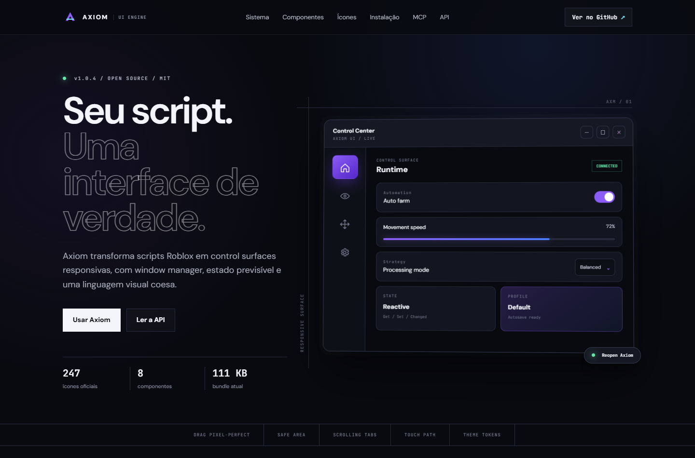

### Olá, eu sou o Ryan 👋

## 💫 Sobre mim

- 🔭 Construindo o **[Axiom UI Engine](https://github.com/Ryanabcraft/AxiomUI)** — framework de UI para scripts Roblox, MIT, com documentação, releases e servidor MCP.
- 🧠 Explorando **agentes de IA** na prática: pontes entre modelos e ferramentas reais (`qoder-claude`, `human-code-mcp`, `zeroreal`).
- 🛠️ Escrevo em **Lua/Luau, TypeScript, Python e Go**, com foco em UI, tooling e DevEx.
- ✍️ Gosto do lado chato e decisivo: instalação em uma linha, build reproduzível, API documentada, release publicada.
- 🌎 Brasil.

## 🚀 Em destaque

### [Axiom UI Engine](https://github.com/Ryanabcraft/AxiomUI) · `Lua` · MIT

Framework de UI para scripts Roblox, distribuído como um único arquivo Luau carregado por `loadstring`. Window manager com drag e resize, modos Desktop/Tablet/Mobile, sidebar com scroll, layouts em colunas, temas semânticos e perfis de configuração persistidos.

- **8 componentes** — button, toggle, slider, dropdown, input, keybind, color picker e card, com handles `Get` / `Set` / `SetVisible` / `Destroy` / `Changed`
- **247 ícones** Lucide validados, mais 51 aliases normalizados (`MapPin`, `map-pin` e `map_pin` são o mesmo asset)
- **1 arquivo, 111 KB** — build em Python que reúne `Core`, `Components`, `Services` e `Themes`
- **Documentação de verdade** — site estático, referência de API, design system e um servidor MCP que entrega os docs para Claude Desktop, Cursor e OpenCode

[Site](https://axiom-ui-engine.vercel.app/) · [API](https://github.com/Ryanabcraft/AxiomUI/blob/main/Documentation/API.md) · [Ícones](https://github.com/Ryanabcraft/AxiomUI/blob/main/Documentation/ICONS.md) · [Design system](https://github.com/Ryanabcraft/AxiomUI/blob/main/Documentation/DESIGN_SYSTEM.md) · [Releases](https://github.com/Ryanabcraft/AxiomUI/releases)

## 📦 Outros projetos

| Projeto | O que faz |
| --- | --- |
| **[qoder-claude](https://github.com/Ryanabcraft/qoder-claude)**  `JavaScript` | Roda o Claude Code nos modelos do Qoder: bridge local compatível com a API da Anthropic, transporte WASM, contexto de 1M, failover entre contas e dashboard ao vivo. |
| **[human-code-mcp](https://github.com/Ryanabcraft/human-code-mcp)**  `TypeScript` | Servidor MCP que dá a agentes como OpenCode, Claude Code e Codex o controle do VS Code real — abrir, digitar, executar e corrigir, tudo visível na tela. |
| **[zeroreal](https://github.com/Ryanabcraft/zeroreal)**  `JavaScript` | Usa ChatGPT, DeepSeek, Gemini e outras IAs da web como agentes do executor Real. Sem API key, sem terminal. |
| **[deepseek-web-proxy](https://github.com/Ryanabcraft/deepseek-web-proxy)**  `Python` | Proxy local compatível com a API da OpenAI para o DeepSeek Web, via ponte no navegador e userscript Tampermonkey. |
| **[deepseek-harness-pc](https://github.com/Ryanabcraft/deepseek-harness-pc)**  `Go` | App nativo para Windows do DeepSeek Harness: janela WebView2, ícone próprio e instalador de uma linha. |
| **[opencode-for-celular](https://github.com/Ryanabcraft/opencode-for-celular)**  `Shell` | OpenCode rodando nativamente no Android/Termux (arm64), instalado com um comando. |
| **[Discord_auto_quest](https://github.com/Ryanabcraft/Discord_auto_quest)**  `Python` | Bot open source que automatiza as quests do Discord. |

## 🧰 Stack

## 📊 Números

 

---

<b>Construindo em público desde 2025.</b> · <a href="https://github.com/Ryanabcraft?tab=repositories">Todos os repositórios</a>

